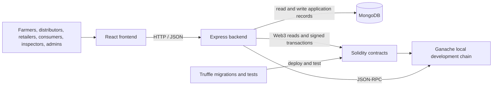

# TABASC

TABASC is a trust-aware blockchain agricultural supply chain with a multi-factor reputation score. It records product registration, custody and shipment milestones, buyer confirmation, feedback, inspections, and reputation using Solidity contracts, an Express API, MongoDB, and a React frontend.

## Architecture



The four contracts divide on-chain responsibilities: `RoleRegistry` manages administrator and supply-chain roles; `ProductContract` registers unique batches and stores farmer, custodian, registration time, delivery window, and a product-data hash; `TrackingContract` enforces custody and shipment progression and records care attestations, buyer assignments, and recalls; `ReputationContract` stores inspections and feedback, computes batch and stakeholder scores, and applies trust/restriction rules. MongoDB stores application accounts and encrypted wallet keystores, product and batch metadata, cached score records, tracking events, audit data, and pending synchronization records. Important chain state and hashes are on-chain, but MongoDB remains a partial source of truth for application data and some displayed history.

## Roles and supply-chain flow

- **Farmer:** registers a batch and initially holds custody.
- **Distributor:** receives custody from the farmer and records pickup, transit, and delivery; records a care attestation at handover to the retailer.
- **Retailer:** receives custody, records shelf/sale progression, and proposes a buyer.
- **Consumer:** confirms the retailer's proposed buyer assignment and may submit feedback for a sold, non-recalled product within the 14-day feedback window.
- **Inspector:** records quality and compliance inspection scores, finalizes scores for actual product participants, and may recall products.
- **Admin:** approves/activates accounts, grants and revokes supply-chain roles, manages reputation configuration, and can suspend a stakeholder.

Registration creates an inactive consumer account, optionally with a requested supply-chain role. An administrator approves and activates the account and grants the corresponding on-chain role. A product proceeds through Harvested, PickedUp, InTransit, Delivered, OnShelf, and Sold. Custody and role checks are enforced at the relevant transitions. Feedback is accepted only from the confirmed buyer; an inspector can finalize after feedback or after the 14-day feedback period has elapsed.

## Reputation scoring

The default batch score combines five basis-point factors: quality (30%), delivery (25%), complaint-free score (20%), compliance (15%), and buyer satisfaction/feedback (10%). Delivery is 10,000 bps if elapsed time is within the delivery window, decreases linearly between one and two delivery windows, and is zero at or beyond two windows. Missing factors are excluded and the remaining weights are normalized. The API's 1–10 consumer rating contributes to both satisfaction and complaint-free score.

The stakeholder score uses an exponential moving average (EMA): the first finalized batch sets the score, and later batches use alpha = 3,000 bps (30% new batch, 70% previous score). Trust levels are `Critical` (<2,000), `Poor` (2,000–3,999), `Average` (4,000–5,999), `Good` (6,000–7,999), and `Excellent` (8,000+). Stakeholder trust labels remain `Unrated` until three batches are finalized. A stakeholder is restricted from receiving custody if suspended, or after at least three finalized batches when their score is below 2,000 bps.

`ReputationContract.applyPenalty` is a contract capability: an inspector can apply one penalty per participant/product only after recall, with a penalty from 1 to 10,000 bps; the score is reduced but not below zero. There is no API route that calls `applyPenalty`.

## Prerequisites and setup (Windows)

The package manifests do not pin a Node.js version. The current development checks use Node.js 24.20.0; Truffle may warn that its optional µWS native binary is incompatible and use its JavaScript fallback. MongoDB and the repository's local Ganache chain are required. Truffle and Ganache are sunset development tools; this setup is for local development, not public-chain production.

1. Install Node.js and MongoDB. From the repository root, install each dependency set:

   ```powershell
   npm ci
   npm ci --prefix client
   npm ci --prefix frontend
   ```

2. In a separate PowerShell window, start the persistent local Ganache chain:

   ```powershell
   npm run ganache:start --prefix client
   ```

   It listens on `127.0.0.1:8545`, network ID `5777`, and stores local chain data in `ganache-data`. Its deterministic accounts are development-only.

3. Ensure MongoDB is running locally. Copy `.env.example` to `client\.env`; replace the example values with your own development secrets and settings. Do not commit real secrets. `JWT_SECRET` and `WALLET_PASSPHRASE` must each be at least 32 characters. `ADMIN_EMAIL` and `ADMIN_PASSWORD` are needed when seeding the administrator. Contract address fields are filled after migration.

   ```powershell
   Copy-Item .\.env.example .\client\.env
   # Edit .\client\.env and replace every placeholder with local development values.
   ```

4. Deploy the contracts to the local chain, then write their addresses into the backend environment:

   ```powershell
   npm run contracts:migrate --prefix client
   npm run sync:env --prefix client
   ```

   A migration deploys new contract instances; it does not transfer prior chain state.

5. Create the administrator using the `ADMIN_EMAIL` and `ADMIN_PASSWORD` configured in `client\.env`, then synchronize approved roles if restoring existing accounts:

   ```powershell
   npm run seed:admin --prefix client
   npm run sync:roles --prefix client
   ```

6. In separate PowerShell windows, start the backend and frontend:

   ```powershell
   npm start --prefix client
   npm start --prefix frontend
   ```

   The frontend uses `http://localhost:5000/api` by default; set `VITE_API_URL` in `frontend\.env` for a different API URL. Check `GET http://localhost:5000/api/health` for database, chain, deployed contract, and pending-sync status.

Full development details and additional recovery/reconciliation instructions are in [`DEV_SETUP.md`](DEV_SETUP.md).

## Tests and simulations

Run commands from the repository root:

```powershell
# Solidity contract tests (Truffle)
npm run contracts:test

# Backend/client tests (also compiles contracts through pretest)
npm test --prefix client

# Frontend tests
npm test --prefix frontend

# Frontend production build
npm run build --prefix frontend

# Gas report during Truffle tests
$env:REPORT_GAS = 'true'
npm run contracts:test
Remove-Item Env:\REPORT_GAS

# Negative API checks (requires a running local API and test fixtures/tokens)
node .\client\scripts\negative-tests.js

# Reproducible off-chain reputation simulation; writes its CSV evidence
node .\client\scripts\baseline-comparison.js
```

The negative API script reads role tokens and fixture identifiers from environment variables, reports missing configuration as skipped cases, and writes its results to `docs/evidence/negative-tests-output.txt`. Use only a disposable local/test system. The baseline simulation is not field data. The Truffle parity test `test/reputation-sim-parity.test.js` checks the JavaScript scoring formulas against the contracts.

## Evidence index

| File | What it shows |
|---|---|
| [`docs/THREAT_MODEL.md`](docs/THREAT_MODEL.md) | Scope, assets, actors, attack scenarios, current defenses, residual risks, and future work. |
| [`docs/evidence/baseline-comparison.md`](docs/evidence/baseline-comparison.md) | Assumptions and summary of the 100-seed reputation simulation. |
| [`docs/evidence/baseline-comparison.csv`](docs/evidence/baseline-comparison.csv) | Per-actor/per-batch aggregate simulation output. |
| [`docs/evidence/gas-report.md`](docs/evidence/gas-report.md) | Local Truffle gas measurements under the documented compiler and optimizer settings. |
| [`docs/evidence/negative-tests-output.txt`](docs/evidence/negative-tests-output.txt) | Captured negative API test output, including cases skipped for missing fixtures. |
| [`docs/evidence/postman-tests.md`](docs/evidence/postman-tests.md) | The negative/role Postman request cases, expected responses, and fixture requirements. |
| [`docs/evidence/slither.md`](docs/evidence/slither.md) | Slither findings and analysis limitations for the reported contract scans. |
| [`docs/evidence/raw/slither-product.txt`](docs/evidence/raw/slither-product.txt) | Raw Slither attempt for `ProductContract.sol`; compiler launch failed. |
| [`docs/evidence/raw/slither-role-registry.txt`](docs/evidence/raw/slither-role-registry.txt) | Raw Slither attempt for `RoleRegistry.sol`; compiler launch failed. |
| [`docs/evidence/raw/slither-reputation.txt`](docs/evidence/raw/slither-reputation.txt) | Raw Slither findings for `ReputationContract.sol`. |
| [`docs/evidence/raw/slither-tracking.txt`](docs/evidence/raw/slither-tracking.txt) | Raw Slither findings for `TrackingContract.sol`. |

## Limitations

- The configured chain is local Ganache only. Truffle and Ganache are sunset tools, not a production public-network deployment.
- Inspection and finalization rely on a single trusted inspector; the code has no second-inspector approval.
- A retailer-proposed fake buyer can inflate feedback. In the documented simulation the colluder is ranked last by TABASC but is not restricted; the result is assumed simulation behavior, not field evidence.
- The EMA forgets old batches quickly: at alpha 3,000 bps its e-folding window is about 3.3 batches and roughly 95% of score weight is on the latest 9 batches.
- The participation agreement documents acceptance and may deter misuse, but is a legal/organizational deterrent, not technical enforcement or identity verification.
- MongoDB is a partial source of truth. Product hash checks and on-chain state help verify selected fields, but cached metadata, user records, and some tracking events depend on MongoDB and pending synchronization.
- No field data is presented; reputation comparisons are simulations and test results, not measured supply-chain outcomes.
- The checkup log records that an earlier frontend development dependency advisory was fixed and both client/frontend audits then reported zero vulnerabilities. Dependency audits are time-sensitive and should be rerun before release; do not treat the historical result as a current audit.

## Repository layout

- `.postman/` — Postman workspace metadata.
- `.vscode/` — editor/workspace settings.
- `build/` — generated Truffle contract artifacts.
- `client/` — Express API, MongoDB models, blockchain integration, and backend scripts/tests.
- `contracts/` — current Solidity contracts and interfaces.
- `docs/` — setup, project notes, threat model, and evidence.
- `frontend/` — React/Vite user interface and tests.
- `ganache-data/` — persistent local development-chain data.
- `legacy/` — superseded original contracts, kept for comparison only.
- `migrations/` — Truffle deployment scripts.
- `node_modules/` — root Node.js dependencies installed by npm.
- `postman/` — Postman collections and request definitions.
- `test/` — Truffle contract tests.
